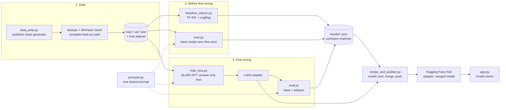

# IT Ticket Triage with QLoRA

Fine-tune a small open LLM ([`ibm-granite/granite-3.3-2b-instruct`](https://huggingface.co/ibm-granite/granite-3.3-2b-instruct))
with **QLoRA** to read an IT helpdesk ticket and answer with strict JSON:

```json
{"category": "Network", "priority": "High"}
```

Categories: Hardware, Software, Network, Access/Accounts, Email, Security, Printer, Other ·
Priorities: Low, Medium, High, Critical. Includes a fair **before/after evaluation** against the base
model (zero-/few-shot) and a classic TF-IDF baseline, a model card generated from the results, and a
Gradio demo.

| | Hugging Face |
|---|---|
| LoRA adapter | [shreyabatra6/granite-3.3-2b-instruct-it-ticket-triage-lora](https://huggingface.co/shreyabatra6/granite-3.3-2b-instruct-it-ticket-triage-lora) |
| Merged model | [shreyabatra6/granite-3.3-2b-instruct-it-ticket-triage](https://huggingface.co/shreyabatra6/granite-3.3-2b-instruct-it-ticket-triage) |
| Dataset (synthetic) | [shreyabatra6/it-ticket-triage](https://huggingface.co/datasets/shreyabatra6/it-ticket-triage) |

## Results

<!-- RESULTS:START -->
Test split: 404 tickets whose problem templates never appear in training. Strict JSON parsing; best value per column in bold. `-` = not run yet.

| Model | Cat Acc | Cat F1 | Prio Acc | Prio F1 | Exact Match | Valid JSON % |
|---|---:|---:|---:|---:|---:|---:|
| TF-IDF + LogReg | **94.6%** | **0.942** | **72.8%** | **0.723** | **67.8%** | n/a |
| Base zero-shot | - | - | - | - | - | - |
| Base few-shot (k=3) | - | - | - | - | - | - |
| LoRA fine-tuned | - | - | - | - | - | - |

<sub>Generated by `make readme` from `results/*.json`.</sub>
<!-- RESULTS:END -->

## Demo

[`app.py`](app.py) is a small Gradio app: paste a ticket, get the JSON back.

```bash
python app.py            # http://127.0.0.1:7860 (also runs on CPU: ~10 GB RAM, a few seconds per ticket)
python app.py --share    # in Colab: also prints a temporary public *.gradio.live link
```

By default it loads the base model plus the published adapter. Set
`MODEL_ID=shreyabatra6/granite-3.3-2b-instruct-it-ticket-triage` to load the merged model instead.
The same app can be deployed as a Hugging Face Space with `make publish-space` (Gradio Spaces need
a Hugging Face PRO account).

## What this project demonstrates

- **A fair comparison.** The base model and the fine-tuned model see the *same* prompt
  ([`prompts.py`](prompts.py)), checked token-for-token at training start. Few-shot examples come
  from the training split only.
- **Honest scoring.** An answer counts only if the whole output is valid JSON with known labels;
  nothing is repaired. A separate lenient score shows how much of the base model's failure is formatting.
- **No leakage.** Validation/test tickets use problem templates that never appear in training
  (a random split let TF-IDF memorise templates and score 100% on category), plus a MinHash
  near-duplicate check.
- **Answer-only loss.** QLoRA SFT where only the JSON answer tokens carry loss (verified on real batches).
- **Reproducible.** One config file, fixed seeds, library versions and GPU recorded with every result,
  and a CPU smoke test that runs the whole pipeline in about 10 minutes without a GPU.

## Architecture



## Repository layout

```
config.yaml / config.py   single source of truth: labels, models, hyperparameters, paths, repo names
prompts.py                the one prompt builder (zero-/few-shot, training rows, consistency check)
ticket_templates.py       hand-written building blocks for the synthetic generator
data_prep.py              generate -> dedupe -> split -> MinHash leak check -> dataset card -> (push)
baseline_classic.py       TF-IDF + logistic regression baseline
eval.py                   evaluate any model: base, base + adapter, or merged; zero-/few-shot
metrics.py                strict JSON parsing, metrics, confusion matrices, results files
modeling.py               model/tokenizer loading and batched greedy generation
train_lora.py             QLoRA fine-tuning with TRL's SFTTrainer
merge_and_publish.py      model cards, merge, push adapter + merged model (optional Space), README results
model_card_template.md    Jinja2 template for the model cards
app.py, space/            Gradio demo and (optional) Hugging Face Space files
notebooks/train_colab.ipynb  the whole pipeline on a Colab T4
results/                  metrics JSON, predictions and plots (committed)
```

## Reproduce

### On Colab (GPU, about 2 hours)

[](https://colab.research.google.com/github/ShreyaBatra6/it-ticket-triage-lora/blob/main/notebooks/train_colab.ipynb)

Open [`notebooks/train_colab.ipynb`](notebooks/train_colab.ipynb) in Colab, select a **T4 GPU**
runtime, add a Hugging Face write token as the Colab secret `HF_TOKEN`, and run the cells in order.
The notebook runs the steps below and pushes the dataset, adapter and merged model. Training alone
takes about 45 minutes; keep the tab open, because free Colab sessions can disconnect and lose all files.

### Locally

Python **3.11+**. Everything has a `--smoke` mode (SmolLM2-135M, 50 tickets, 10 training steps,
CPU, no 4-bit) so the full pipeline can be tested without a GPU.

```bash
python -m venv .venv && source .venv/bin/activate   # Windows: .venv\Scripts\activate
make install-cpu        # CPU torch + pinned requirements (GPU machines: make install)
make smoke              # whole pipeline end to end on CPU, no Hub push (~10 min)
```

On Windows without `make`, `mingw32-make` works with the same targets.

| Target | What it does |
|---|---|
| `make data` / `make data-push` | generate the synthetic dataset (and push it to the Hub) |
| `make baseline` | TF-IDF baseline + base model zero-shot and few-shot evaluation |
| `make train` | QLoRA fine-tuning (CUDA, ~45 min on a T4); logs in `tensorboard --logdir outputs/tensorboard` |
| `make eval` | evaluate base model + trained adapter |
| `make publish-dry` | build model cards and the merged model locally in `outputs/hub/` |
| `make eval-merged` | (optional) evaluate the merged bf16 weights directly |
| `make publish` | push adapter and merged model |
| `make publish-space` | (optional) also deploy the demo as a Space; needs Hugging Face PRO |
| `make readme` | refresh the results table above from `results/*.json` |
| `make demo` | run the Gradio demo locally |
| `make smoke` | everything above on a tiny model, CPU, dry-run publishing |

Secrets come from environment variables or a local `.env` (see [`.env.example`](.env.example));
nothing is hard-coded.

## Configuration

All labels, label definitions, model ids, hyperparameters and repo names live in
[`config.yaml`](config.yaml). The label definitions are inserted into the prompt and the model card,
so they are edited in one place. If you change the category set, add matching templates to
[`ticket_templates.py`](ticket_templates.py) (or generate tickets for the new labels with
`python data_prep.py --llm N`).

## Limitations

- The data is **synthetic**: real tickets are longer and messier, and follow each organisation's own
  categories. Expect lower accuracy on real tickets; re-evaluate on your own labelled data.
- **Priority is subjective**; the dataset deliberately includes 3% priority disagreement, and the
  model inherits the priority conventions of the generator.
- English only. Ticket text is untrusted input; keep a human in the loop.

## License

Code: Apache-2.0, matching the base model's license.
